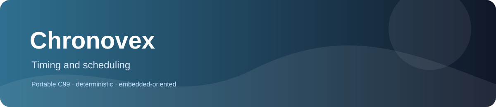

# Chronovex
  



Portable C99 timing primitives for duration scaling, modular timer elapsed time, checked absolute deadlines, and signed remaining-time calculations.

## Contracts at a glance

- Only `pc_motion_duration_u32` uses modulo-2^32 arithmetic. It can recover elapsed ticks only when the true elapsed interval is less than one full 32-bit timer cycle. At or beyond one full cycle, elapsed time is ambiguous.
- `pc_time_deadline_from_now_u64` uses absolute, non-wrapping timestamps and rejects an overflowing `now + delay`, preserving the output on failure.
- `pc_time_until_deadline_i64` returns `deadline - now` only when that signed difference fits in `int64_t`; it rejects larger differences and preserves the output on failure.
- `pc_anim_duration_scale_u32` uses nearest-even rounding and rejects a rounded result larger than `UINT32_MAX`. The product of its two `uint32_t` inputs is exactly representable in `uint64_t`.

Chronovex does **not** make all deadline APIs wrap-safe. See the [API reference](docs/API_REFERENCE.md) for valid ranges and failure behavior.

## Quick start

```sh
cmake -S . -B build -DCHRONOVEX_BUILD_TESTS=ON -DCHRONOVEX_STRICT_WARNINGS=ON
cmake --build build --config Release --parallel
ctest --test-dir build -C Release --output-on-failure
```

For direct integration, include the needed header, for example `#include <chronovex/timing/pc_motion_duration_u32.h>`, and compile its matching `src/pc_motion_duration_u32.c`. No operating system, heap, or third-party library is required.

## Documentation

| Need | Read |
|---|---|
| Choose a primitive | [Family guide](docs/FAMILY_GUIDE.md) |
| Check contracts and test mapping | [API reference](docs/API_REFERENCE.md) |
| Reproduce checks and inspect evidence | [Testing report](docs/TESTING.md) |
| Review design and dependencies | [Architecture](docs/ARCHITECTURE.md) |
| Check target measurements and limits | [Performance](docs/PERFORMANCE.md) |
| Review findings | [Audit register](docs/AUDIT.md) |

## Project layout and validation

There are four public headers and four public callable APIs. Each has a direct enabled test in `tests/test_audit.c`; the CTest suite has three programs. The audit test contains 100,000 fixed-seed differential cases per API plus explicit boundaries, invalid parameters, and output-preservation checks. Checks do not use `assert()` and remain active in Release.

The CMake target `chronovex` is a static C99 library. Testing is optional through `CHRONOVEX_BUILD_TESTS`; strict warnings are enabled by default. All four APIs passed targeted expected-value checks on an ESP32-S3 at 240 MHz. See `docs/TESTING.md` and `docs/PERFORMANCE.md` for exact host and device evidence, including limitations.

## License

Apache License 2.0, copyright Vanderhell. See [LICENSE](LICENSE) and [NOTICE](NOTICE).

## Origin

Chronovex is a standalone embedded-C library extracted from the PrimitiveCore product catalog.
