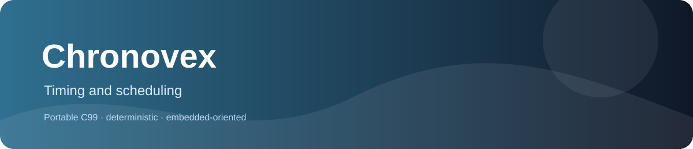

# Chronovex

  



Chronovex provides four small timing primitives for embedded applications: duration scaling with nearest-even rounding, elapsed-time arithmetic for a wrapping 32-bit counter, checked construction of absolute deadlines, and signed remaining-time calculations. Typical uses include animation timing, peripheral timeouts, scheduler deadlines, and timestamp conversion.

The library is deterministic, uses caller-owned inputs and outputs, and requires no heap, operating system, or third-party runtime library.

## API categories

- **Duration scaling:** `chronovex_anim_duration_scale_u32`
- **Wrapping timer elapsed time:** `chronovex_motion_duration_u32`
- **Absolute deadline arithmetic:** `chronovex_time_deadline_from_now_u64`, `chronovex_time_until_deadline_i64`

Only `chronovex_motion_duration_u32` uses modulo-2^32 arithmetic. It represents the elapsed interval only when the true interval is less than one full counter cycle. At or beyond that, elapsed time is ambiguous. Absolute timestamp functions reject unrepresentable results; they do not provide a general wrap-aware deadline comparison.

## Quick start

```c
#include <stdint.h>
#include <chronovex/timing/motion_duration_u32.h>
#include <chronovex/timing/time_deadline_from_now_u64.h>

int main(void)
{
    uint32_t elapsed = chronovex_motion_duration_u32(UINT32_MAX - UINT32_C(2), UINT32_C(3));
    uint64_t deadline = 0u;
    if (elapsed != 6u) return 1;
    if (!chronovex_time_deadline_from_now_u64(UINT64_C(1000), UINT64_C(250), &deadline)) return 2;
    return deadline == UINT64_C(1250) ? 0 : 3;
}
```

## Build and integration

The static library requires C99. Tests and examples are disabled by default when used as a dependency.

```sh
cmake -S . -B build -DCHRONOVEX_BUILD_TESTS=ON -DCHRONOVEX_BUILD_EXAMPLES=ON
cmake --build build --config Release
ctest --test-dir build -C Release --output-on-failure
cmake --install build --prefix install
```

Installed CMake consumers can use `find_package(Chronovex CONFIG REQUIRED)` and link `Chronovex::Chronovex`. Source consumers can use `add_subdirectory()` and link the same target. For selective source integration, include only the required header and compile its matching file under `src/`; the library uses explicit source lists.

The v0.1 header paths and `pc_` function spellings remain source-compatible through forwarding headers and macros. New integrations should use the `chronovex_` API and headers without the historical prefix. The compatibility headers do not export duplicate legacy linker symbols; applications should rebuild from source when migrating.

## Validation and documentation

The test suite directly exercises all four APIs with deterministic differential and boundary tests in Debug and Release. It also compiles a C++98 consumer smoke test when a C++ compiler is available. CI covers GCC, Clang, MSVC, ASan, and UBSan; exact results and evidence limits are in [Testing](docs/TESTING.md). Hardware and performance evidence is recorded separately in [Performance](docs/PERFORMANCE.md).

Read the [API reference](docs/API_REFERENCE.md), [family guide](docs/FAMILY_GUIDE.md), [architecture](docs/ARCHITECTURE.md), and [audit register](docs/AUDIT.md) for contracts and limitations.

## License

Apache License 2.0, copyright Vanderhell. See [LICENSE](LICENSE) and [NOTICE](NOTICE).
